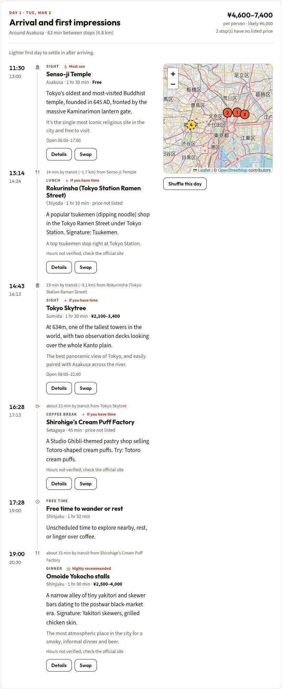
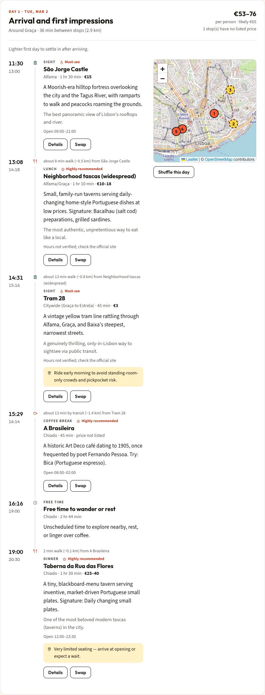
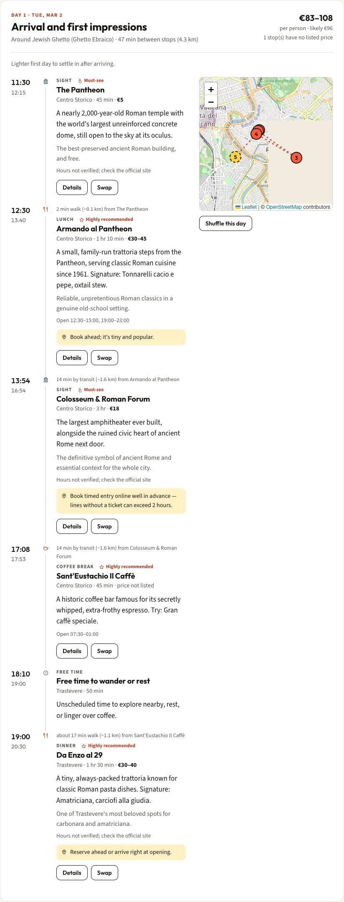

# Sekai stress test

Phase 1 report. Nothing has been fixed yet.

- Server: `http://localhost:3300` (production build), commit `8542869`
- Run: 2026-10-30T16:21:25.875Z, 31 min, 4 parallel workers, fixed seed `stress-v1`
- Cities: 50. Plans built and checked in the browser: **2900**. Plans with at least one failure: **52**. Distinct failure types: **6**.
- Map tiles in this run: a local 1x1 PNG stub for every plan; real OpenStreetMap tiles only in the three-city check below.

## Failures by type

| Type | Failures | Plans | Cities | Meaning | First example |
| --- | ---: | ---: | ---: | --- | --- |
| `time.meal-window` | 37 | 34 | 10 | a meal lands outside a sensible window | dubai I:swap: day 1 16:45 "Arabian Tea House" is lunch at 16:45, expected 11:30-15:30 |
| `interest.photography` | 7 | 7 | 6 | selected interest has no matching stop | dublin F:luxury: "photography" selected and the city has 1 venue(s) for it, but no matching stop in 2 day(s) |
| `interest.history` | 6 | 6 | 6 | selected interest has no matching stop | dubai I:swap: "history" selected and the city has 3 venue(s) for it, but no matching stop in 4 day(s) |
| `prop.travellers` | 4 | 4 | 4 | a single-input change did not propagate correctly | london I:travellers: party total 1098, expected 365.9 x 3 |
| `interest.culture` | 1 | 1 | 1 | selected interest has no matching stop | sydney D:combo-5: "culture" selected and the city has 1 venue(s) for it, but no matching stop in 3 day(s) |
| `interest.nightlife` | 1 | 1 | 1 | selected interest has no matching stop | cairo I:dietary: "nightlife" selected and the city has 5 venue(s) for it, but no matching stop in 4 day(s) |

## Pass/fail matrix

Each cell counts the plans in that group; a cell shows ✅ when every plan passed, otherwise ❌ with `failing/total`. Group I is the chain of single-input changes.

| City | A length | B dates | C travellers | D interests | E diet and walking | F travel styles | G must include / skip | H flight times | I propagation |
| --- | :---: | :---: | :---: | :---: | :---: | :---: | :---: | :---: | :---: |
| Tokyo | ✅ 4 | ✅ 3 | ✅ 3 | ✅ 14 | ✅ 6 | ✅ 12 | ✅ 2 | ✅ 4 | ✅ 10 |
| Paris | ✅ 4 | ✅ 3 | ✅ 3 | ✅ 14 | ✅ 6 | ✅ 12 | ✅ 2 | ✅ 4 | ✅ 10 |
| London | ✅ 4 | ✅ 3 | ✅ 3 | ✅ 14 | ✅ 6 | ✅ 12 | ✅ 2 | ✅ 4 | ❌ 1/10 |
| Dubai | ✅ 4 | ✅ 3 | ✅ 3 | ✅ 14 | ✅ 6 | ✅ 12 | ✅ 2 | ✅ 4 | ❌ 2/10 |
| Singapore | ✅ 4 | ✅ 3 | ✅ 3 | ❌ 2/14 | ✅ 6 | ✅ 12 | ✅ 2 | ❌ 1/4 | ✅ 10 |
| Bangkok | ✅ 4 | ✅ 3 | ✅ 3 | ✅ 14 | ✅ 6 | ✅ 12 | ✅ 2 | ✅ 4 | ✅ 10 |
| Rome | ✅ 4 | ✅ 3 | ✅ 3 | ✅ 14 | ✅ 6 | ✅ 12 | ✅ 2 | ✅ 4 | ✅ 10 |
| Barcelona | ✅ 4 | ✅ 3 | ✅ 3 | ✅ 14 | ✅ 6 | ✅ 12 | ✅ 2 | ✅ 4 | ✅ 10 |
| New York City | ✅ 4 | ✅ 3 | ✅ 3 | ✅ 14 | ✅ 6 | ✅ 12 | ✅ 2 | ✅ 4 | ❌ 1/10 |
| Istanbul | ❌ 1/4 | ✅ 3 | ✅ 3 | ❌ 1/14 | ✅ 6 | ✅ 12 | ✅ 2 | ✅ 4 | ✅ 10 |
| Seoul | ✅ 4 | ✅ 3 | ✅ 3 | ✅ 14 | ✅ 6 | ✅ 12 | ✅ 2 | ✅ 4 | ✅ 10 |
| Amsterdam | ✅ 4 | ✅ 3 | ✅ 3 | ✅ 14 | ✅ 6 | ✅ 12 | ✅ 2 | ✅ 4 | ❌ 1/10 |
| Copenhagen | ✅ 4 | ✅ 3 | ❌ 1/3 | ✅ 14 | ❌ 1/6 | ✅ 12 | ✅ 2 | ✅ 4 | ❌ 1/10 |
| Hong Kong | ✅ 4 | ✅ 3 | ✅ 3 | ✅ 14 | ✅ 6 | ✅ 12 | ✅ 2 | ✅ 4 | ❌ 2/10 |
| Sydney | ❌ 2/4 | ✅ 3 | ✅ 3 | ❌ 1/14 | ✅ 6 | ✅ 12 | ✅ 2 | ✅ 4 | ✅ 10 |
| Zurich | ✅ 4 | ✅ 3 | ✅ 3 | ✅ 14 | ✅ 6 | ✅ 12 | ✅ 2 | ✅ 4 | ✅ 10 |
| Los Angeles | ✅ 4 | ✅ 3 | ✅ 3 | ✅ 14 | ✅ 6 | ✅ 12 | ✅ 2 | ✅ 4 | ✅ 10 |
| Kuala Lumpur | ✅ 4 | ✅ 3 | ✅ 3 | ✅ 14 | ✅ 6 | ✅ 12 | ✅ 2 | ✅ 4 | ✅ 10 |
| Vienna | ✅ 4 | ✅ 3 | ✅ 3 | ✅ 14 | ✅ 6 | ✅ 12 | ✅ 2 | ✅ 4 | ✅ 10 |
| Lisbon | ✅ 4 | ✅ 3 | ✅ 3 | ✅ 14 | ✅ 6 | ✅ 12 | ✅ 2 | ✅ 4 | ✅ 10 |
| Prague | ✅ 4 | ✅ 3 | ✅ 3 | ✅ 14 | ✅ 6 | ✅ 12 | ✅ 2 | ✅ 4 | ✅ 10 |
| Berlin | ✅ 4 | ✅ 3 | ✅ 3 | ✅ 14 | ✅ 6 | ✅ 12 | ✅ 2 | ✅ 4 | ✅ 10 |
| Madrid | ✅ 4 | ✅ 3 | ✅ 3 | ✅ 14 | ✅ 6 | ✅ 12 | ✅ 2 | ✅ 4 | ✅ 10 |
| Milan | ✅ 4 | ✅ 3 | ✅ 3 | ✅ 14 | ✅ 6 | ✅ 12 | ✅ 2 | ✅ 4 | ✅ 10 |
| Florence | ✅ 4 | ✅ 3 | ✅ 3 | ✅ 14 | ✅ 6 | ✅ 12 | ✅ 2 | ✅ 4 | ✅ 10 |
| Venice | ✅ 4 | ✅ 3 | ✅ 3 | ✅ 14 | ✅ 6 | ✅ 12 | ✅ 2 | ✅ 4 | ❌ 1/10 |
| Athens | ❌ 1/4 | ✅ 3 | ✅ 3 | ✅ 14 | ✅ 6 | ✅ 12 | ✅ 2 | ✅ 4 | ✅ 10 |
| Budapest | ✅ 4 | ✅ 3 | ✅ 3 | ✅ 14 | ✅ 6 | ✅ 12 | ✅ 2 | ✅ 4 | ✅ 10 |
| Munich | ✅ 4 | ✅ 3 | ✅ 3 | ✅ 14 | ✅ 6 | ✅ 12 | ✅ 2 | ✅ 4 | ✅ 10 |
| Edinburgh | ✅ 4 | ✅ 3 | ✅ 3 | ✅ 14 | ✅ 6 | ✅ 12 | ✅ 2 | ✅ 4 | ✅ 10 |
| Dublin | ✅ 4 | ✅ 3 | ✅ 3 | ✅ 14 | ✅ 6 | ❌ 2/12 | ✅ 2 | ✅ 4 | ✅ 10 |
| Brussels | ✅ 4 | ✅ 3 | ✅ 3 | ✅ 14 | ✅ 6 | ✅ 12 | ✅ 2 | ✅ 4 | ❌ 1/10 |
| Stockholm | ✅ 4 | ✅ 3 | ✅ 3 | ✅ 14 | ✅ 6 | ✅ 12 | ✅ 2 | ✅ 4 | ✅ 10 |
| Krakow | ✅ 4 | ✅ 3 | ✅ 3 | ✅ 14 | ✅ 6 | ✅ 12 | ✅ 2 | ✅ 4 | ❌ 1/10 |
| Marrakesh | ❌ 2/4 | ❌ 2/3 | ❌ 2/3 | ✅ 14 | ✅ 6 | ✅ 12 | ✅ 2 | ❌ 1/4 | ❌ 2/10 |
| Cairo | ✅ 4 | ✅ 3 | ✅ 3 | ✅ 14 | ✅ 6 | ✅ 12 | ✅ 2 | ✅ 4 | ❌ 1/10 |
| Cape Town | ✅ 4 | ✅ 3 | ✅ 3 | ❌ 1/14 | ❌ 1/6 | ✅ 12 | ✅ 2 | ❌ 2/4 | ✅ 10 |
| Mexico City | ✅ 4 | ✅ 3 | ✅ 3 | ✅ 14 | ✅ 6 | ✅ 12 | ✅ 2 | ✅ 4 | ✅ 10 |
| Buenos Aires | ✅ 4 | ✅ 3 | ✅ 3 | ✅ 14 | ✅ 6 | ✅ 12 | ✅ 2 | ✅ 4 | ✅ 10 |
| Rio de Janeiro | ✅ 4 | ✅ 3 | ✅ 3 | ✅ 14 | ✅ 6 | ✅ 12 | ✅ 2 | ✅ 4 | ✅ 10 |
| Toronto | ✅ 4 | ✅ 3 | ✅ 3 | ✅ 14 | ✅ 6 | ✅ 12 | ✅ 2 | ✅ 4 | ✅ 10 |
| San Francisco | ❌ 3/4 | ❌ 2/3 | ❌ 2/3 | ✅ 14 | ✅ 6 | ✅ 12 | ✅ 2 | ❌ 3/4 | ❌ 1/10 |
| Chicago | ✅ 4 | ✅ 3 | ✅ 3 | ✅ 14 | ✅ 6 | ✅ 12 | ✅ 2 | ✅ 4 | ✅ 10 |
| Miami | ✅ 4 | ✅ 3 | ✅ 3 | ✅ 14 | ✅ 6 | ✅ 12 | ✅ 2 | ❌ 1/4 | ✅ 10 |
| Kyoto | ✅ 4 | ✅ 3 | ✅ 3 | ✅ 14 | ✅ 6 | ✅ 12 | ✅ 2 | ✅ 4 | ✅ 10 |
| Osaka | ✅ 4 | ✅ 3 | ✅ 3 | ✅ 14 | ✅ 6 | ✅ 12 | ✅ 2 | ✅ 4 | ❌ 1/10 |
| Taipei | ✅ 4 | ✅ 3 | ✅ 3 | ✅ 14 | ✅ 6 | ✅ 12 | ✅ 2 | ✅ 4 | ✅ 10 |
| Hanoi | ✅ 4 | ✅ 3 | ✅ 3 | ✅ 14 | ✅ 6 | ✅ 12 | ✅ 2 | ✅ 4 | ❌ 1/10 |
| Mumbai | ✅ 4 | ✅ 3 | ✅ 3 | ✅ 14 | ✅ 6 | ✅ 12 | ✅ 2 | ✅ 4 | ✅ 10 |
| Melbourne | ✅ 4 | ✅ 3 | ✅ 3 | ✅ 14 | ✅ 6 | ✅ 12 | ✅ 2 | ✅ 4 | ✅ 10 |

## Real map tiles (Tokyo, Lisbon, Rome)

Run one city at a time, one tile request at a time with a 1 s pause, capped at 30 requests per city.

| City | Tiles loaded (naturalWidth > 0) | Tile requests | Attribution | Result |
| --- | ---: | ---: | ---: | --- |
| Tokyo | 3 | 4 | 12px | ✅ |
| Lisbon | 3 | 4 | 12px | ✅ |
| Rome | 3 | 4 | 12px | ✅ |

## Failure details

Every failure, grouped by type, with the scenario it came from. The exact inputs of each scenario are in the appendix.

### `time.meal-window` (37)

a meal lands outside a sensible window

- **dubai** `I:swap`: day 1 16:45 "Arabian Tea House" is lunch at 16:45, expected 11:30-15:30
- **dubai** `I:swap`: day 1 19:08 "Arabian Tea House courtyard" is coffee at 19:08, expected 14:00-18:30
- **dubai** `I:shuffle`: day 1 16:45 "Arabian Tea House" is lunch at 16:45, expected 11:30-15:30
- **dubai** `I:shuffle`: day 1 19:08 "Arabian Tea House courtyard" is coffee at 19:08, expected 14:00-18:30
- **singapore** `D:combo-3`: day 2 20:24 "Tian Tian Hainanese Chicken Rice (Maxwell)" is lunch at 20:24, expected 11:30-15:30
- **singapore** `D:combo-5`: day 2 20:24 "Tian Tian Hainanese Chicken Rice (Maxwell)" is lunch at 20:24, expected 11:30-15:30
- **istanbul** `A:7d`: day 6 16:20 "Cibalikapı Balıkçısı" is lunch at 16:20, expected 11:30-15:30
- **istanbul** `D:combo-5`: day 3 15:50 "Develi" is lunch at 15:50, expected 11:30-15:30
- **copenhagen** `C:max-pax`: day 2 15:50 "Restaurant Schønnemann" is lunch at 15:50, expected 11:30-15:30
- **copenhagen** `E:limited-mobility`: day 2 15:50 "Restaurant Schønnemann" is lunch at 15:50, expected 11:30-15:30
- **copenhagen** `I:dietary`: day 2 15:58 "Manfreds" is lunch at 15:58, expected 11:30-15:30
- **hong-kong** `I:swap`: day 1 16:55 "Lin Heung Tea House" is lunch at 16:55, expected 11:30-15:30
- **hong-kong** `I:shuffle`: day 1 16:55 "Lin Heung Tea House" is lunch at 16:55, expected 11:30-15:30
- **sydney** `A:7d`: day 4 15:42 "Mr. Crackles" is lunch at 15:42, expected 11:30-15:30
- **sydney** `A:14d`: day 3 15:42 "Mr. Crackles" is lunch at 15:42, expected 11:30-15:30
- **athens** `A:14d`: day 3 15:56 "Karamanlidika tou Fani" is lunch at 15:56, expected 11:30-15:30
- **marrakesh** `A:3d`: day 2 16:07 "Al Fassia" is lunch at 16:07, expected 11:30-15:30
- **marrakesh** `A:7d`: day 2 15:47 "Al Fassia" is lunch at 15:47, expected 11:30-15:30
- **marrakesh** `B:weekend-start`: day 2 16:22 "Al Fassia" is lunch at 16:22, expected 11:30-15:30
- **marrakesh** `B:closed-day`: day 2 16:22 "Al Fassia" is lunch at 16:22, expected 11:30-15:30
- **marrakesh** `C:1-pax`: day 2 16:07 "Al Fassia" is lunch at 16:07, expected 11:30-15:30
- **marrakesh** `C:2-pax`: day 2 16:07 "Al Fassia" is lunch at 16:07, expected 11:30-15:30
- **marrakesh** `H:arrive-only`: day 2 16:07 "Al Fassia" is lunch at 16:07, expected 11:30-15:30
- **marrakesh** `I:baseline`: day 2 16:02 "Al Fassia" is lunch at 16:02, expected 11:30-15:30
- **marrakesh** `I:start-date`: day 2 16:02 "Al Fassia" is lunch at 16:02, expected 11:30-15:30
- **cape-town** `D:cafes`: day 1 19:08 "Origin Coffee Roasting" is coffee at 19:08, expected 14:00-18:30
- **cape-town** `E:limited-mobility`: day 2 15:42 "Kalky's Fish & Chips" is lunch at 15:42, expected 11:30-15:30
- **cape-town** `E:limited-mobility`: day 2 19:00 "Truth Coffee" is coffee at 19:00, expected 14:00-18:30
- **san-francisco** `A:3d`: day 2 15:34 "Swan Oyster Depot" is lunch at 15:34, expected 11:30-15:30
- **san-francisco** `A:7d`: day 4 16:28 "Swan Oyster Depot" is lunch at 16:28, expected 11:30-15:30
- **san-francisco** `A:14d`: day 3 15:58 "Swan Oyster Depot" is lunch at 15:58, expected 11:30-15:30
- **san-francisco** `B:weekend-start`: day 2 15:34 "La Taqueria" is lunch at 15:34, expected 11:30-15:30
- **san-francisco** `B:closed-day`: day 2 15:34 "La Taqueria" is lunch at 15:34, expected 11:30-15:30
- **san-francisco** `C:1-pax`: day 2 15:34 "Swan Oyster Depot" is lunch at 15:34, expected 11:30-15:30
- **san-francisco** `C:2-pax`: day 2 15:34 "Swan Oyster Depot" is lunch at 15:34, expected 11:30-15:30
- **san-francisco** `H:arrive-only`: day 2 15:34 "Swan Oyster Depot" is lunch at 15:34, expected 11:30-15:30
- **san-francisco** `I:start-date`: day 2 15:34 "The Slanted Door" is lunch at 15:34, expected 11:30-15:30

### `interest.photography` (7)

selected interest has no matching stop

- **dublin** `F:luxury`: "photography" selected and the city has 1 venue(s) for it, but no matching stop in 2 day(s)
- **dublin** `F:shopping`: "photography" selected and the city has 1 venue(s) for it, but no matching stop in 2 day(s)
- **krakow** `I:swap`: "photography" selected and the city has 4 venue(s) for it, but no matching stop in 4 day(s)
- **cape-town** `H:both-1day`: "photography" selected and the city has 9 venue(s) for it, but no matching stop in 1 day(s)
- **san-francisco** `H:arrive-late`: "photography" selected and the city has 9 venue(s) for it, but no matching stop in 2 day(s)
- **miami** `H:both-1day`: "photography" selected and the city has 7 venue(s) for it, but no matching stop in 1 day(s)
- **hanoi** `I:swap`: "photography" selected and the city has 5 venue(s) for it, but no matching stop in 4 day(s)

### `interest.history` (6)

selected interest has no matching stop

- **dubai** `I:swap`: "history" selected and the city has 3 venue(s) for it, but no matching stop in 4 day(s)
- **singapore** `H:both-1day`: "history" selected and the city has 5 venue(s) for it, but no matching stop in 1 day(s)
- **brussels** `I:swap`: "history" selected and the city has 5 venue(s) for it, but no matching stop in 4 day(s)
- **cape-town** `H:arrive-late`: "history" selected and the city has 7 venue(s) for it, but no matching stop in 2 day(s)
- **san-francisco** `H:both-1day`: "history" selected and the city has 5 venue(s) for it, but no matching stop in 1 day(s)
- **osaka** `I:shuffle`: "history" selected and the city has 4 venue(s) for it, but no matching stop in 4 day(s)

### `prop.travellers` (4)

a single-input change did not propagate correctly

- **london** `I:travellers`: party total 1098, expected 365.9 x 3
- **new-york-city** `I:travellers`: party total 1457, expected 485.5 x 3
- **amsterdam** `I:travellers`: party total 683, expected 227.5 x 3
- **venice** `I:travellers`: party total 950, expected 316.5 x 3

### `interest.culture` (1)

selected interest has no matching stop

- **sydney** `D:combo-5`: "culture" selected and the city has 1 venue(s) for it, but no matching stop in 3 day(s)

### `interest.nightlife` (1)

selected interest has no matching stop

- **cairo** `I:dietary`: "nightlife" selected and the city has 5 venue(s) for it, but no matching stop in 4 day(s)

## Informational (not counted as failures)

- `prop.shuffle-noop` x9: shuffling a day gave the same day
- `must.missing-with-warning` x2: a must-include place could not be scheduled and the plan says so

## Appendix: exact inputs of every failing scenario

`slug/scenario`: inputs as set in the form (dates empty means undated; `mustInclude`/`avoid` are record ids).

- `london/I:travellers` one more adult (2 to 3): `{"start":"2027-06-02","end":"2027-06-05","duration":5,"adults":3,"children":0,"pace":"balanced","budget":"mid-range","mobility":"standard","travelStyle":"first-time","interests":["food","history","photography"],"dietary":[],"mustInclude":[],"avoid":[],"arrivalTime":"","departureTime":"","slug":"london"}`
- `dubai/I:swap` swap one stop for the first suggested alternative: `{"start":"2027-05-05","end":"2027-05-08","duration":5,"adults":3,"children":0,"pace":"balanced","budget":"mid-range","mobility":"limited","travelStyle":"first-time","interests":["food","history","photography","nightlife"],"dietary":["vegetarian"],"mustInclude":[],"avoid":[],"arrivalTime":"","departureTime":"","slug":"dubai"}`
- `dubai/I:shuffle` shuffle day 2: `{"start":"2027-05-05","end":"2027-05-08","duration":5,"adults":3,"children":0,"pace":"balanced","budget":"mid-range","mobility":"limited","travelStyle":"first-time","interests":["food","history","photography","nightlife"],"dietary":["vegetarian"],"mustInclude":[],"avoid":[],"arrivalTime":"","departureTime":"","slug":"dubai"}`
- `singapore/D:combo-3` 3 interests together: `{"start":"","end":"","duration":3,"adults":2,"children":0,"pace":"balanced","budget":"mid-range","mobility":"standard","travelStyle":"first-time","interests":["cafes","beaches","adventure"],"dietary":[],"mustInclude":[],"avoid":[],"arrivalTime":"","departureTime":"","slug":"singapore"}`
- `singapore/D:combo-5` 5 interests together: `{"start":"","end":"","duration":3,"adults":2,"children":0,"pace":"balanced","budget":"mid-range","mobility":"standard","travelStyle":"first-time","interests":["beaches","adventure","history","art","culture"],"dietary":[],"mustInclude":[],"avoid":[],"arrivalTime":"","departureTime":"","slug":"singapore"}`
- `singapore/H:both-1day` 1-day trip, landing 10:00 and flight 20:00: `{"start":"","end":"","duration":1,"adults":2,"children":0,"pace":"balanced","budget":"mid-range","mobility":"standard","travelStyle":"first-time","interests":["food","history","photography"],"dietary":[],"mustInclude":[],"avoid":[],"arrivalTime":"10:00","departureTime":"20:00","slug":"singapore"}`
- `new-york-city/I:travellers` one more adult (2 to 3): `{"start":"2027-09-08","end":"2027-09-11","duration":5,"adults":3,"children":0,"pace":"balanced","budget":"mid-range","mobility":"standard","travelStyle":"first-time","interests":["food","history","photography"],"dietary":[],"mustInclude":[],"avoid":[],"arrivalTime":"","departureTime":"","slug":"new-york-city"}`
- `istanbul/A:7d` 7-day trip, undated: `{"start":"","end":"","duration":7,"adults":2,"children":0,"pace":"balanced","budget":"mid-range","mobility":"standard","travelStyle":"first-time","interests":["food","history","photography"],"dietary":[],"mustInclude":[],"avoid":[],"arrivalTime":"","departureTime":"","slug":"istanbul"}`
- `istanbul/D:combo-5` 5 interests together: `{"start":"","end":"","duration":3,"adults":2,"children":0,"pace":"balanced","budget":"mid-range","mobility":"standard","travelStyle":"first-time","interests":["luxury","history","art","nature","adventure"],"dietary":[],"mustInclude":[],"avoid":[],"arrivalTime":"","departureTime":"","slug":"istanbul"}`
- `amsterdam/I:travellers` one more adult (2 to 3): `{"start":"2027-03-24","end":"2027-03-27","duration":5,"adults":3,"children":0,"pace":"balanced","budget":"mid-range","mobility":"standard","travelStyle":"first-time","interests":["food","history","photography"],"dietary":[],"mustInclude":[],"avoid":[],"arrivalTime":"","departureTime":"","slug":"amsterdam"}`
- `copenhagen/C:max-pax` 12 adults + 8 children: `{"start":"","end":"","duration":3,"adults":12,"children":8,"pace":"balanced","budget":"mid-range","mobility":"standard","travelStyle":"first-time","interests":["food","history","photography"],"dietary":[],"mustInclude":[],"avoid":[],"arrivalTime":"","departureTime":"","slug":"copenhagen"}`
- `copenhagen/E:limited-mobility` limited mobility: `{"start":"","end":"","duration":3,"adults":2,"children":0,"pace":"balanced","budget":"mid-range","mobility":"limited","travelStyle":"first-time","interests":["food","photography","history"],"dietary":[],"mustInclude":[],"avoid":[],"arrivalTime":"","departureTime":"","slug":"copenhagen"}`
- `copenhagen/I:dietary` add Vegetarian: `{"start":"2027-07-28","end":"2027-07-31","duration":5,"adults":3,"children":0,"pace":"balanced","budget":"mid-range","mobility":"standard","travelStyle":"first-time","interests":["food","history","photography","nightlife"],"dietary":["vegetarian"],"mustInclude":[],"avoid":[],"arrivalTime":"","departureTime":"","slug":"copenhagen"}`
- `hong-kong/I:swap` swap one stop for the first suggested alternative: `{"start":"2027-03-10","end":"2027-03-13","duration":5,"adults":3,"children":0,"pace":"balanced","budget":"mid-range","mobility":"limited","travelStyle":"first-time","interests":["food","history","photography","nightlife"],"dietary":["vegetarian"],"mustInclude":[],"avoid":[],"arrivalTime":"","departureTime":"","slug":"hong-kong"}`
- `hong-kong/I:shuffle` shuffle day 2: `{"start":"2027-03-10","end":"2027-03-13","duration":5,"adults":3,"children":0,"pace":"balanced","budget":"mid-range","mobility":"limited","travelStyle":"first-time","interests":["food","history","photography","nightlife"],"dietary":["vegetarian"],"mustInclude":[],"avoid":[],"arrivalTime":"","departureTime":"","slug":"hong-kong"}`
- `sydney/A:7d` 7-day trip, undated: `{"start":"","end":"","duration":7,"adults":2,"children":0,"pace":"balanced","budget":"mid-range","mobility":"standard","travelStyle":"first-time","interests":["food","history","photography"],"dietary":[],"mustInclude":[],"avoid":[],"arrivalTime":"","departureTime":"","slug":"sydney"}`
- `sydney/A:14d` 14-day trip, undated: `{"start":"","end":"","duration":14,"adults":2,"children":0,"pace":"balanced","budget":"mid-range","mobility":"standard","travelStyle":"first-time","interests":["food","history","photography"],"dietary":[],"mustInclude":[],"avoid":[],"arrivalTime":"","departureTime":"","slug":"sydney"}`
- `sydney/D:combo-5` 5 interests together: `{"start":"","end":"","duration":3,"adults":2,"children":0,"pace":"balanced","budget":"mid-range","mobility":"standard","travelStyle":"first-time","interests":["cafes","beaches","adventure","culture","luxury"],"dietary":[],"mustInclude":[],"avoid":[],"arrivalTime":"","departureTime":"","slug":"sydney"}`
- `venice/I:travellers` one more adult (2 to 3): `{"start":"2027-09-08","end":"2027-09-11","duration":5,"adults":3,"children":0,"pace":"balanced","budget":"mid-range","mobility":"standard","travelStyle":"first-time","interests":["food","history","photography"],"dietary":[],"mustInclude":[],"avoid":[],"arrivalTime":"","departureTime":"","slug":"venice"}`
- `athens/A:14d` 14-day trip, undated: `{"start":"","end":"","duration":14,"adults":2,"children":0,"pace":"balanced","budget":"mid-range","mobility":"standard","travelStyle":"first-time","interests":["food","history","photography"],"dietary":[],"mustInclude":[],"avoid":[],"arrivalTime":"","departureTime":"","slug":"athens"}`
- `dublin/F:luxury` style: luxury: `{"start":"","end":"","duration":2,"adults":2,"children":0,"pace":"balanced","budget":"mid-range","mobility":"standard","travelStyle":"luxury","interests":["history","food","photography"],"dietary":[],"mustInclude":[],"avoid":[],"arrivalTime":"","departureTime":"","slug":"dublin"}`
- `dublin/F:shopping` style: shopping: `{"start":"","end":"","duration":2,"adults":2,"children":0,"pace":"balanced","budget":"mid-range","mobility":"standard","travelStyle":"shopping","interests":["history","food","photography"],"dietary":[],"mustInclude":[],"avoid":[],"arrivalTime":"","departureTime":"","slug":"dublin"}`
- `brussels/I:swap` swap one stop for the first suggested alternative: `{"start":"2027-06-09","end":"2027-06-12","duration":5,"adults":3,"children":0,"pace":"balanced","budget":"mid-range","mobility":"limited","travelStyle":"first-time","interests":["food","history","photography","nightlife"],"dietary":["vegetarian"],"mustInclude":[],"avoid":[],"arrivalTime":"","departureTime":"","slug":"brussels"}`
- `krakow/I:swap` swap one stop for the first suggested alternative: `{"start":"2027-05-26","end":"2027-05-29","duration":5,"adults":3,"children":0,"pace":"balanced","budget":"mid-range","mobility":"limited","travelStyle":"first-time","interests":["food","history","photography","nightlife"],"dietary":["vegetarian"],"mustInclude":[],"avoid":[],"arrivalTime":"","departureTime":"","slug":"krakow"}`
- `marrakesh/A:3d` 3-day trip, undated: `{"start":"","end":"","duration":3,"adults":2,"children":0,"pace":"balanced","budget":"mid-range","mobility":"standard","travelStyle":"first-time","interests":["food","history","photography"],"dietary":[],"mustInclude":[],"avoid":[],"arrivalTime":"","departureTime":"","slug":"marrakesh"}`
- `marrakesh/A:7d` 7-day trip, undated: `{"start":"","end":"","duration":7,"adults":2,"children":0,"pace":"balanced","budget":"mid-range","mobility":"standard","travelStyle":"first-time","interests":["food","history","photography"],"dietary":[],"mustInclude":[],"avoid":[],"arrivalTime":"","departureTime":"","slug":"marrakesh"}`
- `marrakesh/B:weekend-start` Sat to Mon, from 2027-06-19: `{"start":"2027-06-19","end":"2027-06-21","duration":5,"adults":2,"children":0,"pace":"balanced","budget":"mid-range","mobility":"standard","travelStyle":"first-time","interests":["food","history","photography"],"dietary":[],"mustInclude":[],"avoid":[],"arrivalTime":"","departureTime":"","slug":"marrakesh"}`
- `marrakesh/B:closed-day` 3 days around the busiest closing day (weekday 0, 1 venues closed), from 2027-06-19: `{"start":"2027-06-19","end":"2027-06-21","duration":5,"adults":2,"children":0,"pace":"balanced","budget":"mid-range","mobility":"standard","travelStyle":"first-time","interests":["food","history","photography"],"dietary":[],"mustInclude":[],"avoid":[],"arrivalTime":"","departureTime":"","slug":"marrakesh"}`
- `marrakesh/C:1-pax` 1 traveller: `{"start":"","end":"","duration":3,"adults":1,"children":0,"pace":"balanced","budget":"mid-range","mobility":"standard","travelStyle":"first-time","interests":["food","history","photography"],"dietary":[],"mustInclude":[],"avoid":[],"arrivalTime":"","departureTime":"","slug":"marrakesh"}`
- `marrakesh/C:2-pax` 2 travellers: `{"start":"","end":"","duration":3,"adults":2,"children":0,"pace":"balanced","budget":"mid-range","mobility":"standard","travelStyle":"first-time","interests":["food","history","photography"],"dietary":[],"mustInclude":[],"avoid":[],"arrivalTime":"","departureTime":"","slug":"marrakesh"}`
- `marrakesh/H:arrive-only` landing 09:10 on day 1: `{"start":"","end":"","duration":3,"adults":2,"children":0,"pace":"balanced","budget":"mid-range","mobility":"standard","travelStyle":"first-time","interests":["food","history","photography"],"dietary":[],"mustInclude":[],"avoid":[],"arrivalTime":"09:10","departureTime":"","slug":"marrakesh"}`
- `marrakesh/I:baseline` 3 days from 2027-06-15, 2 adults: `{"start":"2027-06-15","end":"2027-06-17","duration":5,"adults":2,"children":0,"pace":"balanced","budget":"mid-range","mobility":"standard","travelStyle":"first-time","interests":["food","history","photography"],"dietary":[],"mustInclude":[],"avoid":[],"arrivalTime":"","departureTime":"","slug":"marrakesh"}`
- `marrakesh/I:start-date` move the start date one day later (same length): `{"start":"2027-06-16","end":"2027-06-18","duration":5,"adults":2,"children":0,"pace":"balanced","budget":"mid-range","mobility":"standard","travelStyle":"first-time","interests":["food","history","photography"],"dietary":[],"mustInclude":[],"avoid":[],"arrivalTime":"","departureTime":"","slug":"marrakesh"}`
- `cairo/I:dietary` add Vegetarian: `{"start":"2027-07-14","end":"2027-07-17","duration":5,"adults":3,"children":0,"pace":"balanced","budget":"mid-range","mobility":"standard","travelStyle":"first-time","interests":["food","history","photography","nightlife"],"dietary":["vegetarian"],"mustInclude":[],"avoid":[],"arrivalTime":"","departureTime":"","slug":"cairo"}`
- `cape-town/D:cafes` interest: cafes only: `{"start":"","end":"","duration":2,"adults":2,"children":0,"pace":"balanced","budget":"mid-range","mobility":"standard","travelStyle":"first-time","interests":["cafes"],"dietary":[],"mustInclude":[],"avoid":[],"arrivalTime":"","departureTime":"","slug":"cape-town"}`
- `cape-town/E:limited-mobility` limited mobility: `{"start":"","end":"","duration":3,"adults":2,"children":0,"pace":"balanced","budget":"mid-range","mobility":"limited","travelStyle":"first-time","interests":["food","photography","history"],"dietary":[],"mustInclude":[],"avoid":[],"arrivalTime":"","departureTime":"","slug":"cape-town"}`
- `cape-town/H:arrive-late` landing 23:15 on day 1: `{"start":"","end":"","duration":2,"adults":2,"children":0,"pace":"balanced","budget":"mid-range","mobility":"standard","travelStyle":"first-time","interests":["food","history","photography"],"dietary":[],"mustInclude":[],"avoid":[],"arrivalTime":"23:15","departureTime":"","slug":"cape-town"}`
- `cape-town/H:both-1day` 1-day trip, landing 10:00 and flight 20:00: `{"start":"","end":"","duration":1,"adults":2,"children":0,"pace":"balanced","budget":"mid-range","mobility":"standard","travelStyle":"first-time","interests":["food","history","photography"],"dietary":[],"mustInclude":[],"avoid":[],"arrivalTime":"10:00","departureTime":"20:00","slug":"cape-town"}`
- `san-francisco/A:3d` 3-day trip, undated: `{"start":"","end":"","duration":3,"adults":2,"children":0,"pace":"balanced","budget":"mid-range","mobility":"standard","travelStyle":"first-time","interests":["food","history","photography"],"dietary":[],"mustInclude":[],"avoid":[],"arrivalTime":"","departureTime":"","slug":"san-francisco"}`
- `san-francisco/A:7d` 7-day trip, undated: `{"start":"","end":"","duration":7,"adults":2,"children":0,"pace":"balanced","budget":"mid-range","mobility":"standard","travelStyle":"first-time","interests":["food","history","photography"],"dietary":[],"mustInclude":[],"avoid":[],"arrivalTime":"","departureTime":"","slug":"san-francisco"}`
- `san-francisco/A:14d` 14-day trip, undated: `{"start":"","end":"","duration":14,"adults":2,"children":0,"pace":"balanced","budget":"mid-range","mobility":"standard","travelStyle":"first-time","interests":["food","history","photography"],"dietary":[],"mustInclude":[],"avoid":[],"arrivalTime":"","departureTime":"","slug":"san-francisco"}`
- `san-francisco/B:weekend-start` Sat to Mon, from 2027-07-03: `{"start":"2027-07-03","end":"2027-07-05","duration":5,"adults":2,"children":0,"pace":"balanced","budget":"mid-range","mobility":"standard","travelStyle":"first-time","interests":["food","history","photography"],"dietary":[],"mustInclude":[],"avoid":[],"arrivalTime":"","departureTime":"","slug":"san-francisco"}`
- `san-francisco/B:closed-day` 3 days around the busiest closing day (weekday 0, 3 venues closed), from 2027-07-03: `{"start":"2027-07-03","end":"2027-07-05","duration":5,"adults":2,"children":0,"pace":"balanced","budget":"mid-range","mobility":"standard","travelStyle":"first-time","interests":["food","history","photography"],"dietary":[],"mustInclude":[],"avoid":[],"arrivalTime":"","departureTime":"","slug":"san-francisco"}`
- `san-francisco/C:1-pax` 1 traveller: `{"start":"","end":"","duration":3,"adults":1,"children":0,"pace":"balanced","budget":"mid-range","mobility":"standard","travelStyle":"first-time","interests":["food","history","photography"],"dietary":[],"mustInclude":[],"avoid":[],"arrivalTime":"","departureTime":"","slug":"san-francisco"}`
- `san-francisco/C:2-pax` 2 travellers: `{"start":"","end":"","duration":3,"adults":2,"children":0,"pace":"balanced","budget":"mid-range","mobility":"standard","travelStyle":"first-time","interests":["food","history","photography"],"dietary":[],"mustInclude":[],"avoid":[],"arrivalTime":"","departureTime":"","slug":"san-francisco"}`
- `san-francisco/H:arrive-only` landing 09:10 on day 1: `{"start":"","end":"","duration":3,"adults":2,"children":0,"pace":"balanced","budget":"mid-range","mobility":"standard","travelStyle":"first-time","interests":["food","history","photography"],"dietary":[],"mustInclude":[],"avoid":[],"arrivalTime":"09:10","departureTime":"","slug":"san-francisco"}`
- `san-francisco/H:arrive-late` landing 23:15 on day 1: `{"start":"","end":"","duration":2,"adults":2,"children":0,"pace":"balanced","budget":"mid-range","mobility":"standard","travelStyle":"first-time","interests":["food","history","photography"],"dietary":[],"mustInclude":[],"avoid":[],"arrivalTime":"23:15","departureTime":"","slug":"san-francisco"}`
- `san-francisco/H:both-1day` 1-day trip, landing 10:00 and flight 20:00: `{"start":"","end":"","duration":1,"adults":2,"children":0,"pace":"balanced","budget":"mid-range","mobility":"standard","travelStyle":"first-time","interests":["food","history","photography"],"dietary":[],"mustInclude":[],"avoid":[],"arrivalTime":"10:00","departureTime":"20:00","slug":"san-francisco"}`
- `san-francisco/I:start-date` move the start date one day later (same length): `{"start":"2027-07-07","end":"2027-07-09","duration":5,"adults":2,"children":0,"pace":"balanced","budget":"mid-range","mobility":"standard","travelStyle":"first-time","interests":["food","history","photography"],"dietary":[],"mustInclude":[],"avoid":[],"arrivalTime":"","departureTime":"","slug":"san-francisco"}`
- `miami/H:both-1day` 1-day trip, landing 10:00 and flight 20:00: `{"start":"","end":"","duration":1,"adults":2,"children":0,"pace":"balanced","budget":"mid-range","mobility":"standard","travelStyle":"first-time","interests":["food","history","photography"],"dietary":[],"mustInclude":[],"avoid":[],"arrivalTime":"10:00","departureTime":"20:00","slug":"miami"}`
- `osaka/I:shuffle` shuffle day 2: `{"start":"2027-09-01","end":"2027-09-04","duration":5,"adults":3,"children":0,"pace":"balanced","budget":"mid-range","mobility":"limited","travelStyle":"first-time","interests":["food","history","photography","nightlife"],"dietary":["vegetarian"],"mustInclude":[],"avoid":[],"arrivalTime":"","departureTime":"","slug":"osaka"}`
- `hanoi/I:swap` swap one stop for the first suggested alternative: `{"start":"2027-08-04","end":"2027-08-07","duration":5,"adults":3,"children":0,"pace":"balanced","budget":"mid-range","mobility":"limited","travelStyle":"first-time","interests":["food","history","photography","nightlife"],"dietary":["vegetarian"],"mustInclude":[],"avoid":[],"arrivalTime":"","departureTime":"","slug":"hanoi"}`

## Screenshots

Each city's 3-day plan with its day 1 map is in `reports/screenshots/<city>.jpg` (tiles are the 1x1 stub in these, so the map shows markers on a flat tile).
